<div align="center">



# pig-observational-memory

**Observational memory for [PiG](https://github.com/MichaelKinsy/PiG) and 196 other coding agents: long agent sessions that keep the thread across compactions.**

*Does whatever a spider can, and remembers all of it.*

A PiG extension that gives the agent a lasting memory of the session. It records what happens while you work, by code, and makes compaction a quick render instead of a slow rewrite. The same engine ships as one binary, [`om`](#other-harnesses), for Claude Code, Codex, Cursor, Gemini CLI, Copilot, OpenCode, Pi and the rest.

[](https://github.com/drvova/pig-observational-memory/actions/workflows/ci.yml)
[](https://github.com/MichaelKinsy/PiG)
[](docs/harnesses.md)
[](extensions/observational-memory/go.mod)
[](LICENSE)

[Quick start](#quick-start) · [Other harnesses](#other-harnesses) · [How it works](#how-it-works) · [Commands](#commands) · [Configuration](#configuration) · [Docs](#documentation)

</div>

---

## Why

Compaction summarizes the session. The next compaction summarizes that summary. A few rounds later the agent is working from a copy of a copy, and the details that held the work together are gone: why a design was chosen, which approaches were already rejected, what the user clarified, what must not be reopened. Each of those compactions also stalls the session while a model rewrites the past.

This extension does the memory work while the session runs, so it is ready before compaction is needed.

- **No summary chains.** Records are saved as entries in the session, and every compaction renders them as written. They are never re-summarized.
- **No extra requests.** Records are picked out of the conversation by code at every turn end. A compaction makes at most one model request, on the session model, to merge and reflect, in place of PiG's own summarizer; nothing runs between compactions.
- **Traceable memory.** Every line ends with the entry it came from, and the agent can read it back with the `memory` tool (``om.Recall(`<id>`)``), or search the raw history behind the summary. Whatever the summary leaves out is printed as the snippet that lists it.
- **Unread history is never lost.** Before rendering, the compaction reads whatever of the removed range no turn end read, and a record is dropped only when the record replacing it carries every specific it carries.

## Quick start



You need the `pig` CLI and a Go 1.26 or newer toolchain: the `go` on your `PATH`, or one installed with `pig setup go`.

```bash
pig install git:github.com/drvova/pig-observational-memory
```

The first run compiles the extension, so it starts more slowly; later sessions reuse the build.

> [!TIP]
> Want PiG to match this page? Run `/sprite set spider-ham` and the header pig puts on the suit.

Start `pig` and work as usual. Run `/om:status` to confirm the extension loaded: it prints the records recorded so far and PiG's compaction threshold with the context against it. Records are written by code from the first turn end; the only model request is the one a compaction may make, on the session model.

Other ways to load it:

```bash
# this project only (writes .pig/settings.json)
pig install git:github.com/drvova/pig-observational-memory -l

# from a clone: load it for one session, without installing
pig -e ./extensions/observational-memory

# from a clone: install it
pig install ./extensions/observational-memory

# list the hooks, commands and tool it registers, without installing
pig install ./extensions/observational-memory --validate-only --json
```

## Other harnesses

The memory engine is a harness-neutral Go module (`memory/`), and PiG is one adapter on it. The other is
`om`, a single binary that brings the same memory to any coding agent:

```sh
go install github.com/drvova/pig-observational-memory/memory/cmd/om@latest
om harnesses                # every harness om knows, and what each gets
om install claude-code      # or any name from that list
om install codex --dry-run  # print the changes without writing them
om uninstall codex          # take out exactly what install wrote
```

`om install` merges into the harness's own config, beside what is there, and keeps a `.om-backup` of any
file it changes. The store lives under `~/.om` (`$OM_HOME`), so curated memory and kept definitions are
shared across harnesses. What a harness gets depends on what it exposes:

| Tier | What om does | Harnesses |
| --- | --- | --- |
| **Recording and compaction** (43) | Hooks, a plugin or an extension hand om each turn. It records it (level 0), compacts when the harness compacts, and hands the summary back where the harness allows | Claude Code, OpenClaude, Codex, Open Interpreter, Gemini CLI, Qwen Code, Qoder, iFlow, Kimi CLI, Factory Droid, Copilot CLI, Cursor, Cortex Code, Kiro, Cline, Kode, Deep Agents Code, Auggie, Crush, Goose, Amazon Q, Pi, Oh My Pi, Gentle Shell, OpenCode, Kilo Code, Neovate, Amp, Trae, Letta Code, Windsurf, CodeBuddy, Junie, IBM Bob, AdaL, Lingma, Posit Assistant, Tabnine CLI, Mastra Code, Devin CLI, Enconvo, Nanocoder, PiG |
| **The memory tool, installed** (63) | om writes its MCP server into the harness's config | Claude Desktop, Continue, Roo Code, Void, Warp, Jan, Theia IDE, Twinny and more |
| **The memory tool, added by hand** (91) | the harness keeps servers in its own UI, so `om install` prints the steps | JetBrains AI Assistant, Cherry Studio, LM Studio, Msty Studio, Chatbox, OpenHands and more |

How it reads each conversation:

- **From the harness's own transcript**, through a reader in `memory/transcript` written from that
  harness's docs or source. om reads the harness's files and never writes them. Its own entries sit beside
  them in `~/.om/sessions`.
- **From SQLite sessions** (Crush, Goose, Amazon Q), with the `sqlite3` command or Python's `sqlite3`
  module. No database driver is linked into the engine.
- **From hooks that carry the turn's text**, when the harness keeps no transcript om can read. om records
  each prompt and reply in its own transcript under `~/.om/transcripts`.

`om` makes no model request. Level 1 needs the session model, which only PiG hands the engine, so
everywhere else om runs the code-only path: level 0, the rendered summary with its intent and next
sections, ranked search, curated memory and kept definitions.

The engine behind `om` and the PiG extension is the SBCL memory core ([lisp-core.md](docs/lisp-core.md)):
one image per user, built on first use from the sources `om` carries when `sbcl` is on `PATH`
([lisp-build.md](docs/lisp-build.md)), with the Go engine running any event the image could not take
before it acted. `OM_ENGINE=go` (or `"engine": "go"`) is the kill switch; Windows stays on the Go engine.

The readers are tested on transcripts the harnesses themselves wrote (`memory/transcript/testdata/real`,
with sources and licenses), not only on samples built from their docs. Those real files caught gaps the
docs never mentioned, such as Gemini's tool results kept on the call and Droid's injected context, and
each is fixed. Any harness that can run a command at a turn's end can use the generic protocol (`om hook
generic`). [om](docs/universal.md) has the details, and [Harnesses](docs/harnesses.md) lists every harness
and the clients researched and found out of reach.

## How it works


Records (notes) are what happened: a decision, a finished migration, a bug traced to a module, a constraint the user stated. Reflections are what stays true: the stack, a hard deadline, a preference for minimal abstractions. They are saved as entries in the session: the memory ledger.

| Level | Runs when | Writes |
| --- | --- | --- |
| **Level 0**, code | Every turn end, and at a compaction for what no turn end read | Records picked from the conversation: user facts, preferences and corrections, the model's words before a tool call, attempts with their outcome, files, commits. No model request. |
| **Level 1**, one request | At a compaction, on the session model, when it fits (`consolidate`) | Labels, merges, reflections and subject aliases, each checked by code: nothing it proposes may lose a specific |

PiG decides when to compact (or, with PiG's automatic compaction off, the extension asks at PiG's own threshold). The extension owns every compaction PiG prepares, keeps PiG's cut, and writes the summary from memory, like this:

```
These are condensed memories from earlier in this session, as tables: …

reflections[1]{id,dates,content}:
  b2c3d4e5f6a1,2026-01-10,"Hard constraint: ship by January 22nd 2026."
notes.graphql_migration[2]{id,when,kind,status,scope,content,superseded_by,source}:
  d4e5f6a1b2c3,2026-01-15,correction,,public API,"Use GraphQL for the public API, not REST",,m41
  e5f6a1b2c3d4,2026-01-15,attempt,,public API,go test ./api/... worked,,m57
omitted[1]{from,to,count,spans,first_id,last_id,query}:
  2026-01-08,2026-01-14,38,3,m02,m39,om.Notes(om.From(`m02`).Through(`m39`))
```

When a record is too compressed to act on, the agent runs ``om.Recall(`<id>`)`` with the `memory` tool and gets the original conversation back. The `memoryFormat` setting switches to a bracketed line layout; [Summary format](docs/concepts.md#summary-format) describes both.

The summary budget is derived from what PiG reports: never more than PiG's threshold leaves room for, the model's output limit, or what the compaction removed; `compactionSummaryMaxTokens` caps it. Before each request, aged tool results the latest compaction retained are sent as their one-line record and the snippet that recalls the original. [How it works](docs/how-it-works.md) covers the lifecycle and the ledger; [memory v2](docs/memory-v2.md) is the design.

## Commands



| Command | Shows |
| --- | --- |
| `/om:status` | Records by who added them, PiG's compaction threshold and the context against it, the last compaction's level and request count, curated memory, the harness, and any removed setting still set |
| `/om:view` | The memory in the latest compaction summary, also copied to the clipboard; before the first compaction it says how many records exist and points to `/om:view full` |
| `/om:view full` | All memory recorded on this branch except dropped records, also copied to the clipboard |

Commands only read state or settings. The agent reaches its memory through one tool, `memory`, which runs Go code over the `om` API (reads such as `om.Notes`, `om.History` and `om.Recall`, the curated writes, and its own kept functions) in a child process; empty code prints the manual. The tool is the same for every model. [The code tool](docs/code-tool.md) is the design.

```go
om.Notes(om.Search(`sourdough`).Kind(`event`)).Count("subject")
om.History(om.Search(`india online store`).Limit(5))
om.Recall(`3f9a2c1d7b4e`)
om.Save("prefers-tabs", "user", "The user indents with tabs.", om.Quoting("tabs please"))
func bakes() int { return om.Notes(om.Subject("baking")).Len() } // kept for later sessions
```

## Configuration

The defaults suit most sessions, and nothing needs tuning: every threshold and budget comes from PiG. Settings go under the `observational-memory` key in:

- `~/.pig/agent/settings.json`, for every session
- `<project>/.pig/settings.json`, for one project, overriding the global file once PiG trusts the project (until then the extension, like PiG, uses the global file alone)

With `PIG_USE_PI_DIRS=1`, PiG reads Pi's `~/.pi/agent` and `.pi` instead. Settings are read again at each session start (`/new`, `/resume`), so a new session picks up a change; a `/trust` decision needs a PiG restart. [Where settings live](docs/configuration.md#where-settings-live) covers the overrides.

| Setting | Default | Use it to |
| --- | --- | --- |
| `consolidate` | `true` | Set `false` to keep every compaction at level 0: no model request at all |
| `compactionSummaryMaxTokens` | unset | Cap the summary below the budget derived from PiG |
| `memoryFormat` | `"tables"` | Set `"lines"` for the bracketed line layout |
| `curatedMemory` | `true` | Set `false` to turn off the agent's long-lived memory across sessions |
| `passive` | `false` | Stop turn-end extraction, level 1, thinning and the extension's own compaction trigger (or set `PI_OBSERVATIONAL_MEMORY_PASSIVE=1`) |
| `debugLog` | `false` | Write NDJSON debug events to `~/.pig/agent/observational-memory/debug/` |

Settings of the earlier background workers (`model`, `fallbackModel`, `observeAfterTokens`, `compactAfterTokens`, `memoryEngine` and the rest) are ignored, and `/om:status` lists any still set. [Configuration](docs/configuration.md) lists every setting and the removed ones.

## Migrating from the TypeScript extension

If you used the TypeScript Pi extension [pi-observational-memory](https://github.com/elpapi42/pi-observational-memory) (V3), your sessions load here.

- **Sessions carry over.** The ledger entries and compaction details have the same shape, so recorded memory keeps folding, and extraction starts after its coverage.
- **The workers are gone.** Memory is recorded by code and consolidated by at most one request per compaction, so the worker settings are ignored.
- **Some behavior differs**, and [the migration notes](docs/pig.md#migrating-from-the-typescript-extension) list each difference.

## Development

```text
go.work                            the workspace: the engine and its adapters
memory/                            the harness-neutral memory engine, a Go module with no harness SDK
├── hooks/                         turn-end extraction, compaction trigger and hook, level 1, thinning
├── extract/                       level 0: records picked by code
├── consolidate/                   level 1's prompt and its validation
├── selection/, thin/              the summary renderer; thinning aged tool results and day headers
├── ledger/                        memory model, projections
├── agents/                        the single model request
├── runtime/                       per-process state, session model resolution
├── omtool/, om/, omhost/          the memory tool: its surface, the om API, the engine's answers
├── sandbox/, codepolicy/, codestore/  the child process, the code policy, kept definitions
├── legacyquery/                   the frozen recognizer of the removed query language (reads old text, runs nothing)
├── commands/, recall/             /om:status, /om:view, om.Recall evidence
├── curated/, harness/, rules/     long-lived memories, the per-model harness, rules
├── kernel/, layer/, declare/      what no definition may touch; the model-built layer
├── host/, hostinfo/               the interfaces a harness adapter implements, and what it injects
├── engine/                        the session setup every adapter shares
├── neutral/                       a host over any harness's transcript, with om's entries beside it
├── transcript/                    readers for each harness's transcript (testdata/real: their own files)
├── cli/, cmd/om/                  the om binary: hooks, MCP server, installers, the harness registry
├── config/, serialize/, …         settings, source serialization, token estimates, debug log
└── testfix/                       fake host and entry builders for tests
extensions/observational-memory/   the PiG adapter, its own Go module
├── extension.go, memory.go        PiG factory: events, commands, the memory tool
├── hostinfo.go                    hands the engine PiG's directories and token estimate
└── internal/sdkhost/              adapts the PiG SDK's extension context to memory/host
docs/                              concepts, internals, settings, design, PiG port notes, contributing
docs/animation/                    Clayzo sources for the README animations
```

Run the same checks as CI in each module:

```bash
for m in memory extensions/observational-memory; do
  (cd "$m" && test -z "$(gofmt -l .)" && go vet ./... && go test -race ./...)
done
```

[Contributing](docs/contributing.md) says what a pull request needs.

## Documentation

| Page | Covers |
| --- | --- |
| [Concepts](docs/concepts.md) | Vocabulary and the memory model |
| [How it works](docs/how-it-works.md) | Lifecycle, ledger entries, compaction and recall |
| [Memory v2](docs/memory-v2.md) | The design: no requests beyond what PiG makes, levels 0 and 1, migration |
| [Configuration](docs/configuration.md) | Every setting, debugging and the removed settings |
| [PiG extension](docs/pig.md) | Install details, package layout and notes for migrating from the TypeScript extension |
| [Contributing](docs/contributing.md) | Where changes go and which checks they must pass |
| [om: other harnesses](docs/universal.md) | The `om` binary: how it reads each harness, what each tier gets, the generic protocol |
| [Harnesses](docs/harnesses.md) | Every harness `om install` supports, and how (generated) |
| [Memory interface](docs/memory-interface.md) | Tables and codecs, the harness, the kernel and the layer |
| [The code tool](docs/code-tool.md) | The `memory` tool: Go code over the `om` API in a child process |
| [Bench results](docs/bench-results.md) | LongMemEval_s through real PiG sessions |

## Credits

Inspired by [Mastra's Observational Memory](https://mastra.ai/blog/observational-memory) research. The memory model builds on the MIT-licensed TypeScript Pi extension [pi-observational-memory](https://github.com/elpapi42/pi-observational-memory) by [elpapi42](https://github.com/elpapi42) and its contributors. Spider-Ham, PiG's green pig and the PiG. wordmark in the README scenes are PiG's own pixel art, drawn from its [sprite catalogue](https://github.com/MichaelKinsy/PiG/tree/main/coding/piglogin) (MIT), and animated with [Clayzo](docs/animation/README.md).

## License

[MIT](LICENSE)

<br>


