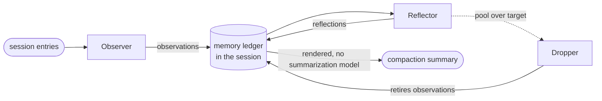

<div align="center">

# pi-observational-memory

**Long PiG sessions that keep the thread.**

Observational memory for [PiG](https://github.com/MichaelKinsy/PiG), Pi in Go. It records what happens while you work,<br>
distills what stays true, and makes compaction a quick render instead of a slow rewrite.

[](https://github.com/drvova/pi-observational-memory/actions/workflows/ci.yml)
[](extensions/observational-memory/go.mod)
[](LICENSE)

[Quick start](#quick-start) · [How it works](#how-it-works) · [Commands](#commands) · [Configuration](#configuration) · [Docs](#documentation)

</div>

---

## Why

Compaction summarizes the session. The next compaction summarizes that summary. A few rounds later the agent is working from a copy of a copy, and the details that held the work together are gone: why a design was chosen, which approaches were already rejected, what the user clarified, what must not be reopened. Each of those compactions also stalls the session while a model rewrites the past.

This extension does the memory work while the session runs, so it is ready before compaction is needed.

- **No summary chains.** Observations and reflections are kept in the session as ledger entries and folded into each compaction. They are never re-summarized.
- **Fast compaction.** When memory is ready, compaction renders it without calling a summarization model. If the observer is behind, a short catch-up run covers the gap first.
- **Traceable memory.** Every line carries an id. The agent can `recall` it to see the source entries it came from.
- **Nothing unread is dropped.** Compaction keeps history the observer has not read yet in context, or hands that one compaction to PiG's native summarizer.

## Quick start

You need the `pig` CLI and a Go 1.26 or newer toolchain: the `go` on your `PATH`, or one installed with `pig setup go`.

```bash
pig install git:github.com/drvova/pi-observational-memory
```

Start a session and work as usual. Memory builds in the background, and `/om:status` shows how far along it is.

The first run compiles the extension; later sessions reuse the build. Other ways to load it:

```bash
# this project only (writes .pig/settings.json)
pig install git:github.com/drvova/pi-observational-memory -l

# from a clone: one session without installing, or install
pig -e ./extensions/observational-memory
pig install ./extensions/observational-memory

# list the hooks, commands and tool it registers, without installing
pig install ./extensions/observational-memory --validate-only --json
```

## How it works



Three memory workers run in one background pipeline. They use the session model unless you configure another.

| Worker | Runs when | Writes |
| --- | --- | --- |
| **Observer** | ~10k tokens of new source since its last coverage (`observeAfterTokens`) | Timestamped observations ranked `low` to `critical`, each citing the source entries it came from |
| **Reflector** | ~20k tokens of newly observed source (`reflectAfterTokens`) | Durable reflections, each citing the observations it preserves |
| **Dropper** | After a reflection, when active observations exceed `observationsPoolTargetTokens` | Retires observations from active memory, favouring ones reflections now cover. The ledger keeps them. |

Observations are what happened: a decision, a finished migration, a bug traced to a module, a constraint the user stated. Reflections are what stays true: the stack, a hard deadline, a preference for minimal abstractions.

Compaction comes either from the extension, once `compactAfterTokens` of observed source has built up since the last compaction, or from PiG itself. Either way the hook folds the ledger into a summary like this:

```md
These are condensed memories from earlier in this session.
…

## Reflections
[a1b2c3d4e5f6] User works at Acme Corp building Acme Dashboard on Next.js 15 with Supabase auth.
[b2c3d4e5f6a1] Hard constraint: ship by January 22nd 2026.

## Observations
[d4e5f6a1b2c3] 2026-01-15 14:30 [high] User decided to switch from REST to GraphQL for the public API; motivation was reducing over-fetching on mobile clients.
[e5f6a1b2c3d4] 2026-01-15 14:50 [medium] GraphQL migration completed; user confirmed queries working.
```

When a line is too compressed to act on, the agent calls `recall` with its id and gets the original source back.

The summary is budgeted (`compactionSummaryMaxTokens`), newest memory first. If nothing has been recorded yet, PiG's native summarizer runs instead of an empty summary. [How it works](docs/how-it-works.md) covers the lifecycle, the ledger and the compaction cut in detail.

## Commands

| Command | Shows |
| --- | --- |
| `/om:status` | Memory counts, progress toward the next observation, reflection and compaction, pool sizes, active backoffs, and the last worker errors |
| `/om:view` | The memory in the latest compaction summary, also copied to the clipboard |
| `/om:view full` | Everything recorded on this branch, also copied to the clipboard |
| `recall` (agent tool) | The source evidence behind one observation or reflection id. It is not a search tool. |

## Configuration

The defaults suit most sessions. Settings go under the `observational-memory` key in:

- `~/.pig/agent/settings.json`, for every session
- `<project>/.pig/settings.json`, for one project, overriding the global file

With `PIG_USE_PI_DIRS=1`, PiG reads Pi's `~/.pi/agent` and `.pi` instead. [Where settings live](docs/configuration.md#where-settings-live) covers the overrides.

The most common change is running the workers on a cheaper model, with a second one to fall back on:

```json
{
  "observational-memory": {
    "model": { "provider": "openrouter", "id": "google/gemma-4-31b-it", "thinking": "low" },
    "fallbackModel": { "provider": "opencode-go", "id": "deepseek-v4.1-flash", "thinking": "low" }
  }
}
```

| Setting | Default | Use it to |
| --- | --- | --- |
| `model` | session model | Run the workers on another model: `{ provider, id, thinking }`. Without `provider`, the id resolves against the session model's provider. |
| `fallbackModel` | unset | Try a second model when the first cannot be resolved, or retry a worker call that failed |
| `observeAfterTokens` | `10000` | Observe more or less often |
| `reflectAfterTokens` | `20000` | Reflect more or less often |
| `compactAfterTokens` | `81000` | Compact earlier or later |
| `compactAfterTokensMode` | `"calibrated"` | Set `"ratio"` to scale the compaction point to the session model's context window (`compactAfterTokensRatio`, default `0.68`) |
| `consolidateWhenIdle` | `false` | Run the workers only between turns, for one local server shared by the agent and the workers |
| `passive` | `false` | Stop background work and auto-compaction (or set `PI_OBSERVATIONAL_MEMORY_PASSIVE=1`) |
| `showWorkerNotifications` | `true` | Hide routine worker progress messages |
| `debugLog` | `false` | Write NDJSON debug events to `~/.pig/agent/observational-memory/debug/` |

Two tips:

- **Large context windows.** On a 1M-token model the fixed 81k threshold compacts far too early. `"compactAfterTokensMode": "ratio"` with `"compactAfterTokensRatio": 0.5` compacts at about 500k instead.
- **Local servers.** If the workers share a llama.cpp server with the agent, set `agentMaxTokens` (for example `8192`) and a lower `observerChunkMaxTokens`, so that a worker request fits in the server's context.

[Configuration](docs/configuration.md) lists every setting with its validation, tuning advice and the V2 migration table.

## Development

```text
extensions/observational-memory/   the extension, a standalone Go module
├── extension.go                   PiG factory: events, commands, recall tool
└── internal/
    ├── hooks/                     consolidation pipeline, compaction trigger and hook
    ├── agents/                    observer, reflector and dropper loops and prompts
    ├── ledger/                    memory model, projections, summary rendering
    ├── runtime/                   per-process state, model resolution
    ├── commands/, recall/         /om:status, /om:view, recall
    ├── sdkhost/                   the only package that imports the PiG SDK
    └── testfix/                   fake host and entry builders for tests
docs/                              concepts, internals, settings, contributing
```

Run the checks CI runs from the module directory:

```bash
cd extensions/observational-memory
gofmt -l .          # must print nothing
go vet ./...
go test -race ./...
```

[Contributing](docs/contributing.md) says what a pull request needs.

## Coming from the TypeScript extension

This is a Go port of [elpapi42/pi-observational-memory](https://github.com/elpapi42/pi-observational-memory) (V3).

- **Sessions carry over.** The ledger entries and compaction details have the same shape, so recorded memory keeps working.
- **Settings carry over.** The keys are the same and are read from PiG's directories, as described above.
- **Some behaviour changed.** The port fixes several upstream issues, and [pig.md](docs/pig.md) lists each change.
- **V2 is still not supported.** V2 settings and memory are ignored; [Migrating from V2](docs/configuration.md#migrating-from-v2) maps the old keys.

## Documentation

| Page | Covers |
| --- | --- |
| [Concepts](docs/concepts.md) | Vocabulary and the memory model |
| [How it works](docs/how-it-works.md) | Lifecycle, ledger entries, projections, compaction and recall |
| [Configuration](docs/configuration.md) | Every setting, tuning, debugging and V2 migration |
| [PiG extension](docs/pig.md) | Install details, package layout and changes from the TypeScript extension |
| [Contributing](docs/contributing.md) | Where changes go and which checks they must pass |

## Credits

Inspired by [Mastra's Observational Memory](https://mastra.ai/blog/observational-memory) research. Ported from the TypeScript extension by [elpapi42](https://github.com/elpapi42) and its contributors.

## License

[MIT](LICENSE)
