<div align="center">



# pig-observational-memory

**Observational memory for [PiG](https://github.com/MichaelKinsy/PiG): long agent sessions that keep the thread across compactions.**

*Does whatever a spider can, and remembers all of it.*

A PiG extension that gives the agent a lasting memory of the session. It records what happens while you work, distills what stays true, and makes compaction a quick render instead of a slow rewrite.

[](https://github.com/drvova/pig-observational-memory/actions/workflows/ci.yml)
[](https://github.com/MichaelKinsy/PiG)
[](extensions/observational-memory/go.mod)
[](LICENSE)

[Quick start](#quick-start) · [How it works](#how-it-works) · [Commands](#commands) · [Configuration](#configuration) · [Docs](#documentation)

</div>

---

## Why

Compaction summarizes the session. The next compaction summarizes that summary. A few rounds later the agent is working from a copy of a copy, and the details that held the work together are gone: why a design was chosen, which approaches were already rejected, what the user clarified, what must not be reopened. Each of those compactions also stalls the session while a model rewrites the past.

This extension does the memory work while the session runs, so it is ready before compaction is needed.

- **No summary chains.** Observations and reflections are saved as entries in the session, and every compaction renders them as written. They are never re-summarized.
- **Fast compaction.** When the observer has already read the history being compacted, the summary is rendered from memory without calling a summarization model. If it is behind, a catch-up run of up to two observer chunks tries to read the rest first.
- **Traceable memory.** Every line carries an id, and the agent can pass it to the `recall` tool to see the conversation it came from.
- **Unread history is never lost.** Compaction keeps history the observer has not read yet in context, or hands that one compaction to PiG's native summarizer.

## Quick start



You need the `pig` CLI and a Go 1.26 or newer toolchain: the `go` on your `PATH`, or one installed with `pig setup go`.

```bash
pig install git:github.com/drvova/pig-observational-memory
```

The first run compiles the extension, so it starts more slowly; later sessions reuse the build.

> [!TIP]
> Want PiG to match this page? Run `/sprite set spider-ham` and the header pig puts on the suit.

Start `pig` and work as usual. Run `/om:status` to confirm the extension loaded: it prints memory counts and a line such as `Next observation: ~2,300 / 10,000 tokens (23%)`. The first observation is recorded after about 10k tokens of conversation. The workers call the session model in the background; [Configuration](#configuration) shows how to use a cheaper one.

Other ways to load it:

```bash
# this project only (writes .pig/settings.json)
pig install git:github.com/drvova/pig-observational-memory -l

# from a clone: load it for one session, without installing
pig -e ./extensions/observational-memory

# from a clone: install it
pig install ./extensions/observational-memory

# list the hooks, commands and tool it registers, without installing
pig install ./extensions/observational-memory --validate-only --json
```

## How it works



Observations are what happened: a decision, a finished migration, a bug traced to a module, a constraint the user stated. Reflections are what stays true: the stack, a hard deadline, a preference for minimal abstractions.



Three memory workers run in one background pipeline and save what they write as entries in the session: the memory ledger. They use the session model unless you configure another.

| Worker | Runs when | Writes |
| --- | --- | --- |
| **Observer** | ~10k tokens of history it has not read yet (`observeAfterTokens`) | Timestamped observations ranked `low` to `critical`, each citing the messages it came from |
| **Reflector** | ~20k tokens of history the observer has read since the last reflection (`reflectAfterTokens`) | Durable reflections, each citing the observations it preserves |
| **Dropper** | After a reflection, when active observations exceed `observationsPoolTargetTokens` | Retires observations from active memory, favoring ones reflections now cover. They stay in the session, and `recall` still finds them by id. |

Compaction starts either from the extension, after about 81k tokens of history the observer has read since the last compaction (`compactAfterTokens`; all history when PiG's automatic compaction is off), or from PiG itself (`/compact`, or a full context window). Either way the extension writes the summary from memory, like this:

```md
These are condensed memories from earlier in this session.
…

## Reflections
[a1b2c3d4e5f6] User works at Acme Corp building Acme Dashboard on Next.js 15 with Supabase auth.
[b2c3d4e5f6a1] Hard constraint: ship by January 22nd 2026.

## Observations
[d4e5f6a1b2c3] 2026-01-15 14:30 [high] User decided to switch from REST to GraphQL for the public API; motivation was reducing over-fetching on mobile clients.
[e5f6a1b2c3d4] 2026-01-15 14:50 [medium] GraphQL migration completed; user confirmed queries working.
```

When a line is too compressed to act on, the agent calls `recall` with its id and gets the original conversation back.

The summary is capped at `compactionSummaryMaxTokens` (an eighth of the context window by default). When memory outgrows it, the oldest lines are left out and a closing line says how many. If nothing has been recorded yet, PiG's native summarizer runs instead of an empty summary. [How it works](docs/how-it-works.md) covers the lifecycle, the ledger and how compaction decides what to keep.

## Commands



| Command | Shows |
| --- | --- |
| `/om:status` | Memory counts, progress toward the next observation, reflection and compaction, memory sizes, any worker or compaction holding off after an empty or failed run, and the last worker errors |
| `/om:view` | The memory in the latest compaction summary (empty until the first compaction), also copied to the clipboard |
| `/om:view full` | All memory recorded on this branch except dropped observations, also copied to the clipboard |
| `recall` (agent tool) | The original conversation behind one observation or reflection id. It is not a search tool. |
| `/om:memory` | The agent's curated memories (all of them, ranked), `/om:memory <name>` for one in full, `/om:memory reload` to re-rank the index on the next request |
| `memory_save`, `memory_edit`, `memory_forget`, `memory_read`, `memory_search`, `memory_feedback` (agent tools) | The agent's own long-lived memory across sessions; see [Curated memory](docs/concepts.md#curated-memory) |

## Configuration

The defaults suit most sessions. Settings go under the `observational-memory` key in:

- `~/.pig/agent/settings.json`, for every session
- `<project>/.pig/settings.json`, for one project, overriding the global file

With `PIG_USE_PI_DIRS=1`, PiG reads Pi's `~/.pi/agent` and `.pi` instead. Settings are read when the extension starts, so restart PiG after changing them. [Where settings live](docs/configuration.md#where-settings-live) covers the overrides.

The most common change is running the workers on a cheaper model, with a second one to fall back on:

```json
{
  "observational-memory": {
    "model": { "provider": "openrouter", "id": "google/gemma-4-31b-it", "thinking": "low" },
    "fallbackModel": { "provider": "opencode-go", "id": "deepseek-v4.1-flash", "thinking": "low" }
  }
}
```

| Setting | Default | Use it to |
| --- | --- | --- |
| `model` | session model | Run the workers on another model: `{ provider, id, thinking }`. Without `provider`, the id resolves against the session model's provider. |
| `fallbackModel` | unset | Try a second model when the first cannot be resolved, or retry a worker call that failed |
| `observeAfterTokens` | `10000` | Observe more or less often |
| `reflectAfterTokens` | `20000` | Reflect more or less often |
| `compactAfterTokens` | `81000` | Compact earlier or later |
| `compactAfterTokensMode` | `"calibrated"` | Set `"ratio"` to scale the compaction point to the session model's context window (`compactAfterTokensRatio`, default `0.68`) |
| `consolidateWhenIdle` | `false` | Run the workers only while the agent is idle (see the local-server tip below) |
| `passive` | `false` | Stop the background workers and the extension's own compaction trigger; PiG's compaction and the summary still work (or set `PI_OBSERVATIONAL_MEMORY_PASSIVE=1`) |
| `showWorkerNotifications` | `true` | Set `false` to hide routine worker progress messages |
| `debugLog` | `false` | Write NDJSON debug events to `~/.pig/agent/observational-memory/debug/` |

Two tips:

- **Large context windows.** On a 1M-token model the default 81k threshold compacts long before the window fills. `"compactAfterTokensMode": "ratio"` with `"compactAfterTokensRatio": 0.5` compacts at about 500k instead.
- **Local servers.** If the workers share a llama.cpp server with the agent, set `consolidateWhenIdle` to `true` so their requests never overlap the agent's, and set `agentMaxTokens` (for example `8192`) and a lower `observerChunkMaxTokens` so that a worker request fits in the server's context.

[Configuration](docs/configuration.md) lists every setting with its validation and tuning advice.

## Migrating from the TypeScript extension

If you used the TypeScript Pi extension [pi-observational-memory](https://github.com/elpapi42/pi-observational-memory) (V3), your sessions and settings work here.

- **Sessions carry over.** The ledger entries and compaction details have the same shape, so recorded memory keeps working.
- **Settings carry over.** The keys are the same and are read from PiG's directories, as described above.
- **Some behavior differs.** Several issues reported against the TypeScript extension are fixed here, and [the migration notes](docs/pig.md#migrating-from-the-typescript-extension) list each difference.
- **V2 data is not read.** Like the TypeScript V3 release, this ignores settings and memory from the older V2 format; [Migrating from V2](docs/configuration.md#migrating-from-v2) maps the old keys.

## Development

```text
extensions/observational-memory/   the extension, a standalone Go module
├── extension.go                   PiG factory: events, commands, recall tool
├── cmd/longmemeval/               LongMemEval benchmark command (not part of the extension)
└── internal/
    ├── hooks/                     consolidation pipeline, compaction trigger and hook
    ├── agents/                    observer, reflector and dropper loops and prompts
    ├── ledger/                    memory model, projections, summary rendering
    ├── runtime/                   per-process state, model resolution
    ├── commands/, recall/         /om:status, /om:view, recall
    ├── host/                      host interfaces the packages run against
    ├── sdkhost/                   adapts the PiG SDK's extension context to host
    ├── config/, serialize/, …     settings, source serialization, token estimates, debug log
    ├── bench/                     LongMemEval harness over the real memory pipeline
    └── testfix/                   fake host and entry builders for tests
docs/                              concepts, internals, settings, PiG port notes, contributing
docs/animation/                    Clayzo sources for the README animations
```

From the module directory, run the same checks as CI:

```bash
cd extensions/observational-memory
gofmt -l .          # must print nothing
go vet ./...
go test -race ./...
```

[Contributing](docs/contributing.md) says what a pull request needs.

## Documentation

| Page | Covers |
| --- | --- |
| [Concepts](docs/concepts.md) | Vocabulary and the memory model |
| [How it works](docs/how-it-works.md) | Lifecycle, ledger entries, projections, compaction and recall |
| [Configuration](docs/configuration.md) | Every setting, tuning, debugging and V2 migration |
| [PiG extension](docs/pig.md) | Install details, package layout and notes for migrating from the TypeScript extension |
| [Contributing](docs/contributing.md) | Where changes go and which checks they must pass |
| [Benchmark](docs/bench.md) | Running LongMemEval against the memory pipeline, and how comparable the numbers are |

## Credits

Inspired by [Mastra's Observational Memory](https://mastra.ai/blog/observational-memory) research. The memory model builds on the MIT-licensed TypeScript Pi extension [pi-observational-memory](https://github.com/elpapi42/pi-observational-memory) by [elpapi42](https://github.com/elpapi42) and its contributors. Spider-Ham, PiG's green pig and the PiG. wordmark in the README scenes are PiG's own pixel art, drawn from its [sprite catalogue](https://github.com/MichaelKinsy/PiG/tree/main/coding/piglogin) (MIT), and animated with [Clayzo](docs/animation/README.md).

## License

[MIT](LICENSE)

<br>


