# LongMemEval results

A full run of [LongMemEval](https://github.com/xiaowu0162/LongMemEval)'s `longmemeval_s` set: 500 questions over 25,112 conversation sessions, set up the way Mastra's observational memory benchmark is. The sessions are replayed in time order through this extension's own observer, reflector and dropper, and each question is answered from the rendered memory. Each answer is graded with LongMemEval's official per-type judge prompts. How to run it is in [bench.md](bench.md).

## Results

The chart is built from [docs/animation/bench-chart.ts](animation/bench-chart.ts) (`npm run export` in `docs/animation`).

| Question type | This extension | Mastra OM, gpt-5-mini actor | Mastra OM, gpt-4o actor |
|---|---|---|---|
| knowledge-update | 96.2% (75/78) | 96.2% | 85.9% |
| multi-session | 89.5% (119/133) | 87.2% | 79.7% |
| single-session-assistant | 76.8% (43/56) | 94.6% | 82.1% |
| single-session-preference | 96.7% (29/30) | 100.0% | 73.3% |
| single-session-user | 97.1% (68/70) | 95.7% | 98.6% |
| temporal-reasoning | 85.7% (114/133) | 95.5% | 85.7% |
| **Overall (unweighted mean of the 6 types)** | **90.32%** | 94.87% | 84.23% |

Plain accuracy is 89.6% (448/500). Abstention questions, those with no answer in the history, were answered correctly in 24 of 30 cases. Mastra's figures are from [their write-up](https://mastra.ai/research/observational-memory).

## Setup and caveats

- **Models.** One model plays every role: observer, reflector, dropper, actor and judge. For 423 questions it was `deepseek-v4.1-flash-uncensored`. The last 77 were finished on `deepseek-v4.1-flash`, the standard variant. Most of those 77 had already ingested part of their history on the first model.
  - The 423: 90.1% (381/423), mean of types 90.18%.
  - The 77, spread across knowledge-update, single-session-assistant and temporal-reasoning: 87.0% (67/77).
- **Judge.** Our judge is that same DeepSeek model, not gpt-4o as in Mastra's and LongMemEval's published numbers. The scores are therefore not strictly comparable.
- **Mastra's observer differs.** Mastra ran gemini-2.5-flash as its observer and reflector, and its actor and judge were other models.
- **Recall is off**, matching Mastra's runner. The actor sees only the rendered memory and the unobserved tail.
- **Usage.** About 361M prompt tokens, 196M of them cache hits, and 22.5M completion tokens, over about 19k model calls.
