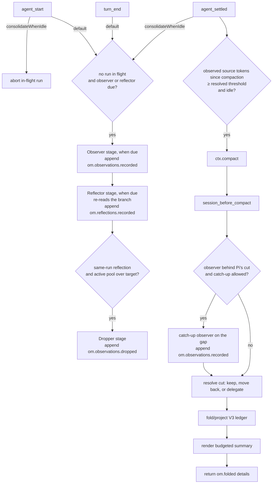

# How it works

This is the V3 technical reference for `pi-observational-memory`.

V3 is ledger-centered: memory state is reconstructed by folding V3 ledger entries on the current branch. When that projection is non-empty, V3 renders it model-free into the summary the agent sees; no summarization model is called. Before rendering, the compaction hook may run the observer synchronously on source Pi's cut would otherwise discard (see [Compaction hook](#compaction-hook)). Empty projections delegate to Pi's native summarizer.

## Runtime entry points

`src/index.ts` (and the Go port's `extension.go`) registers one shared runtime and these Pi surfaces:

| Surface | Purpose |
|---|---|
| `agent_start` / `turn_end` consolidation trigger | Maybe launch one background consolidation run: observer, then reflector, then dropper only after a same-run successful reflection. With `consolidateWhenIdle`, `agent_start` aborts an in-flight run instead and `turn_end` does nothing. |
| `agent_settled` consolidation trigger | With `consolidateWhenIdle` only: launch the consolidation run while Pi is idle, then evaluate proactive compaction after it. |
| `agent_settled` compaction trigger | Maybe call `ctx.compact()` when idle and over the resolved compaction threshold, after Pi finishes retries and queued continuation. |
| `session_before_compact` hook | Resolve the compaction cut, observe an unobserved gap synchronously when allowed, and build the V3 compaction payload. |
| `/om:status` | Show ledger counts, drift, progress clocks, and worker state. |
| `/om:view` | Show visible or full memory content and attempt to copy the rendered memory text. |
| `recall` tool | Recover source evidence for a memory id. |

## Lifecycle overview



One `consolidationInFlight` flag guards a single consolidation pipeline. A run executes its stages in order: the observer stage, then the reflector stage, which re-reads the branch and so sees observations recorded earlier in the same run, then the dropper stage, which runs only after a non-empty same-run reflection. A stage that is not due is skipped and the run moves on; an observer or reflector failure ends the run. With `consolidateWhenIdle`, proactive compaction is also evaluated after the idle run finishes, so memory work on the same settled event does not starve it ([pig.md](pig.md) describes how the Go port orders the two).

## Source entries and progress

V3 raw-token progress counts only source entries:

- `message`
- `custom_message`
- `branch_summary`

Memory ledger entries and compaction entries do not add raw-token progress.

Every V3 ledger entry has `data.coversUpToId`. That field is a progress and projection watermark. The observer and reflector clocks count source tokens after the latest valid watermark for their ledger type; when Pi reports provider context usage, provider-reported context growth since that watermark (or since the latest compaction, when coverage is behind it) also counts, and a stage is due when either measure reaches its threshold:

| Worker/trigger | Progress source |
|---|---|
| Observer | source tokens after the latest `om.observations.recorded.data.coversUpToId` |
| Reflector | observed source tokens: those after the latest `om.reflections.recorded.data.coversUpToId` and up to the latest observation coverage marker |
| Dropper | no clock; runs only after a non-empty same-run reflection, when the folded active observation pool is over `observationsPoolTargetTokens` |
| Auto-compaction | observed source tokens from the latest compaction boundary through the latest observation coverage marker (raw source tokens after the boundary when Pi's `compaction.enabled` is `false`) |

The Go port differs in two details: its reflector is never due on provider growth alone, and its `/om:status` reports the larger of the two measures. See [pig.md](pig.md).

The watermark is also used to decide whether a memory ledger entry belongs to a bounded projection. It is not provenance. Provenance lives in `sourceEntryIds` and `supportingObservationIds`.

## Ledger data shapes

### Observations recorded

```ts
customType: "om.observations.recorded"
data: {
  observations: Observation[];
  coversUpToId: string;
}
```

Each observation:

```ts
type Observation = {
  id: string;
  content: string;
  timestamp: string;
  relevance: "low" | "medium" | "high" | "critical";
  sourceEntryIds: string[];
  tokenCount: number;
}
```

The builder rejects empty observation arrays, so no empty progress entries are written.

### Reflections recorded

```ts
customType: "om.reflections.recorded"
data: {
  reflections: Reflection[];
  coversUpToId: string;
}
```

Each reflection:

```ts
type Reflection = {
  id: string;
  content: string;
  supportingObservationIds: string[];
  tokenCount: number;
}
```

The reflector must cite valid active observation ids.

### Observations dropped

```ts
customType: "om.observations.dropped"
data: {
  observationIds: string[];
  coversUpToId: string;
}
```

Drops are tombstones. They remove ids from active observations but do not delete ledger history.

### Folded compaction details

```ts
details: {
  type: "om.folded";
  version: 1;
  fullFold: boolean;
  observations: Observation[];
  reflections: Reflection[];
  foldThroughEntryId?: string;
}
```

These details are what later visible projections read. The ledger remains the source of truth.

A compaction has two boundaries. The retention boundary is the compaction's `firstKeptEntryId`, which Pi persists: the first entry kept in context. The fold boundary, `foldThroughEntryId`, is the entry through which the ledger was folded into the summary. They are the same entry unless the hook moved the cut back to keep unobserved source in context; then the fold boundary is the latest observation coverage marker. (The Go port also folds through a coverage marker that reaches past Pi's cut; see [pig.md](pig.md).) A later compaction reads the fold boundary of the latest full fold, so it applies exactly the drops and reflections that fold applied. Details written without `foldThroughEntryId` fall back to `firstKeptEntryId`.

## Observer flow

The observer is the first stage of the consolidation pipeline. The pipeline launches from `agent_start` and `turn_end`, or from `agent_settled` with `consolidateWhenIdle`.

1. Load config if needed.
2. Skip the launch if `passive` is true.
3. Skip the launch if `consolidationInFlight` is true.
4. Skip the launch unless the observer or the reflector is due (see [Source entries and progress](#source-entries-and-progress)).
5. In the run, skip the observer stage if its progress is below `observeAfterTokens`; the run moves on to the reflector.
6. Honor any deliberate-empty backoff until another `observeAfterTokens` of source tokens arrive or coverage changes.
7. Resolve the memory model. If no usable model resolves, the run ends.
8. Select the oldest size-capped chunk after the latest observation coverage marker.
9. Serialize those source entries for the observer prompt, with prior memory bounded by `workerMemoryMaxTokens`.
10. Run the observer, retrying once with `fallbackModel` when the call fails.
11. Validate source ids returned by the model.
12. Compute deterministic 12-character ids and per-observation token counts in code.
13. Append `om.observations.recorded` only if at least one observation was accepted.

If no observations are generated, the worker writes no entry and does not advance coverage, and the run continues to the reflector. A later eligible observer run will see a larger range. Deliberate empty runs back off until another `observeAfterTokens` worth of new source tokens arrives, so they do not re-fire every turn. Observer chunks are capped at `observerChunkMaxTokens` (minimum 256); when it is unset, the cap is 20% of the memory model's context window, or 60,000 estimated tokens when the window is unknown. Complete entries are added oldest-first while they fit, so an oversized uncovered span drains in slices; when the oldest entry alone exceeds the cap, it is sent as a clearly marked head/tail excerpt, preventing coverage from stalling while the original entry stays in the session. API/stream failures surface as `observer failed` / `observer.stream_error` rather than as an empty run, and end the run before the reflector. The Go port measures the backoff on the raw backlog and, after a partial run, advances coverage only through the last cited entry; see [pig.md](pig.md).

## Reflect/drop flow

Reflect/drop runs in the same consolidation run, after the observer stage. The reflector stage re-reads the branch, so it sees any observations the observer recorded earlier in the run.

1. Skip the reflector stage if its progress is below `reflectAfterTokens`.
2. Skip it if no observation coverage exists.
3. Resolve the model only for stages that are ready to run.
4. Fold current ledger state.
5. Run the reflector, with prior memory bounded by `workerMemoryMaxTokens` and one retry on `fallbackModel` when the call fails. Each active observation line is annotated with current reflection coverage (`none`, `partial`, or `strong`) so the reflector can review uncovered durable facts without treating coverage as a quota.
6. Append non-empty `om.reflections.recorded` with `coversUpToId` set to the latest observation coverage marker. Support ids are downstream dropper coverage evidence and should include all and only observations whose durable meaning is preserved with equivalent fidelity.
7. Only after that same-run non-empty reflection append, check whether the folded active observation pool is over `observationsPoolTargetTokens`.
8. If over target, run the dropper with same-run reflections available. It computes a maximum drop count from tokens over target converted to an approximate observation count and annotates active observations with reflection coverage tiers (`none`, `partial`, `strong`) for model judgment.
9. Append non-empty `om.observations.dropped` with `coversUpToId` set to the earlier branch position of latest observation coverage and same-run reflection coverage.

Reflector no-output and reflector failure skip the same-run dropper. Dropper failure does not roll back already-appended reflections. The Go port also backs the reflector off after an empty verdict until the memory it reads changes; see [pig.md](pig.md).

## Auto-compaction trigger

The auto-compaction trigger runs on `agent_settled`, after Pi has finished automatic retries, automatic compaction, and queued continuation. With `consolidateWhenIdle`, it is also evaluated after the idle consolidation run finishes.

It skips when:

- `passive` is true;
- compaction is already in flight;
- compaction progress is below the resolved threshold;
- Pi is not idle after the deferred check;
- the threshold is no longer met after the deferred check.

Compaction progress counts observed source tokens: estimated source-entry
tokens from the latest compaction boundary through the latest observation
coverage marker. It is zero without observation coverage or while coverage is
behind the boundary, so unobserved source never pushes compaction. When Pi's
own `compaction.enabled` is `false`, the trigger counts raw estimated source
tokens after the boundary instead. The count starts at `firstKeptEntryId` when
Pi provides that boundary. Memory ledger entries and compaction metadata
contribute zero.

The threshold is resolved by `compactAfterTokensMode`: `"calibrated"` (the
default) uses `compactAfterTokens`; `"ratio"` uses
`floor(contextWindow * compactAfterTokensRatio)` of the session model, falling
back to `compactAfterTokens` when the context window is unknown. The trigger
uses the same metric and threshold before scheduling and in the deferred
re-check, then calls `ctx.compact()` when all checks pass. The Go port polls
idleness for a short while and backs off after a refused compaction; see
[pig.md](pig.md).

Outside `consolidateWhenIdle`, this trigger does not wait for observer, reflector, or dropper promises. That is intentional: background memory work should never make compaction feel stuck.

## Compaction hook

The compaction hook runs on `session_before_compact` and is the critical V3 latency path.

It renders deterministically, and calls a model only to catch the observer up:

1. Guard against duplicate concurrent compaction hooks.
2. Load config if needed.
3. Read `event.preparation.firstKeptEntryId`, `event.preparation.tokensBefore`, and the event's branch entries.
4. Resolve the cut. When observation coverage reaches Pi's `firstKeptEntryId`, keep it and fold through it. When unobserved source in the current compaction range sits before it (the gap), move `firstKeptEntryId` back to the nearest valid cut point at or before the first unobserved entry, so those entries stay in context, and fold through the latest observation coverage marker, within `compactionMaxRetainedTokens`. When that is not possible (overflow recovery, no observation coverage, nothing observed that can be compacted, or a retained tail over budget), the resolution is to delegate.
5. Catch up when there is a gap, `compactionCatchUpMaxChunks` is above `0` (default `2`), observation coverage exists, and no background consolidation run is in flight: run the observer synchronously on the gap, starting at the observation frontier, for up to `compactionCatchUpMaxChunks` chunks, and append `om.observations.recorded` for each chunk that records observations. A chunk that records nothing, fails, or is aborted stops the catch-up. If any chunk recorded, re-read the branch and re-resolve the cut.
6. Build a compaction projection from branch entries through the fold boundary.
7. Render a summary from projected reflections and observations within `compactionSummaryMaxTokens`. If records exist but none fits, delegate.
8. For a moved cut, delegate if the retained tokens plus the summary exceed `compactionMaxRetainedTokens`.
9. If the hook delegates or the summary is empty, return no extension result so Pi uses native compaction.
10. Otherwise return `{ compaction: { summary, firstKeptEntryId, tokensBefore, details } }` where `details.type` is `om.folded` and `details.foldThroughEntryId` is the fold boundary.

It does not:

- call a summarization model;
- run reflector/dropper;
- wait for worker promises (catch-up is skipped while a background consolidation run is in flight);
- append ledger entries other than catch-up `om.observations.recorded` entries.

If another compaction hook is already in flight, it returns `{ cancel: true }`. Delegating an empty projection is intentionally different: Pi proceeds with its native summarizer so pre-cut context is preserved. The Go port's catch-up also retries on `fallbackModel`, and it appends a caller's `customInstructions` to the summary; see [pig.md](pig.md).

## Projections

V3 uses projection helpers so commands, compaction, and recall do not each invent their own truth.

### Full projection

Full projection folds valid V3 observations, reflections, and drops from branch root through the requested boundary. Memory entries are included by resolving their `data.coversUpToId` marker against the boundary, not by the physical position of the `om.*` custom entry. Old V2 entries/details, invalid V3-shaped entries, and dangling coverage markers are ignored.

### Visible projection

Visible projection without a boundary reads the latest V3 `om.folded` compaction details. This is what the agent currently sees.

### Compaction projection

When compaction runs, the projection helper decides whether this compaction is a full fold. It works on the fold boundary: Pi's `firstKeptEntryId`, or the latest observation coverage marker when the hook moved the cut back. It first builds the normal compaction projection: observations whose `coversUpToId` reaches the fold boundary, with reflection/drop effects held stable from the latest full-fold boundary (that compaction's `foldThroughEntryId`, else its `firstKeptEntryId`). If there is no previous full-fold boundary, normal compaction includes observations only and excludes reflections/drops. It sums that projection's active observation `tokenCount`; if the total is at or above `observationsPoolMaxTokens`, it performs a full fold through the fold boundary, applying observations, reflections, and drops by coverage marker. Otherwise, it keeps the normal projection. Either way, the details record the fold boundary as `foldThroughEntryId`.

### Diff projection

Diff projection compares visible memory with full memory. `/om:status` uses this to show recorded-vs-visible drift. `/om:status` also reports the visible observation pool separately from the folded active observation pool because compaction pressure and dropper maintenance intentionally use different projections and thresholds.

## Summary rendering

The renderer returns an empty string when there are no visible observations or reflections. Otherwise it starts with deterministic usage instructions that tell the agent how to treat the memory, how to handle conflicts, and when to use `recall` for exact source context. It then renders reflection and observation sections when those entries exist:

```md
These are condensed memories from earlier in this session.

- Reflections: stable, long-lived facts about the user, project, decisions, and constraints. New reflection lines may include ids in brackets.
- Observations: timestamped events from the conversation history, in chronological order. Observation lines include ids in brackets.

Treat these as past records. When entries conflict, the most recent observation reflects the latest known state. Work that prior observations describe as completed should not be redone unless the user explicitly asks to revisit it.

When exact source context is needed for precision or traceability, use the recall tool with the relevant observation or reflection id. This is especially useful when a reflection materially affects a decision or is too compressed to continue confidently. Do not use recall as broad search or inject raw source unless it is needed.

## Reflections
[id] durable reflection

## Observations
[id] YYYY-MM-DD HH:MM [relevance] timestamped observation
```

The renderer is deterministic. It does not call a model and does not rewrite memory content.

## Commands

### `/om:status`

Shows:

- passive mode, when `passive` is true;
- recorded/dropped/active/visible observation counts, with plain `+N` / `-N` visible-vs-full drift suffixes when drift exists;
- recorded/visible reflection counts, with a plain `+N` drift suffix when full memory has extra reflections;
- `Next observation`: source tokens since observation coverage against `observeAfterTokens`;
- `Next reflection`: observed tokens since reflection coverage against `reflectAfterTokens`;
- `Next compaction`: observed source tokens (estimated source tokens when Pi's `compaction.enabled` is `false`) against the resolved compaction threshold;
- `Observer backlog`: unobserved source tokens since the compaction boundary;
- visible observation pool pressure against `observationsPoolMaxTokens` from visible memory;
- active observation pool pressure against `observationsPoolTargetTokens` from folded active observations;
- reflection pool token total of visible reflections;
- an in-flight section (consolidation run and its phase, auto-compaction, compaction hook) when any is running;
- a last-error section with the last observer, reflector, and dropper errors.

The Go port also shows active observer, reflector, and compaction backoffs, and its progress lines use the same measures the workers act on; see [pig.md](pig.md).

### `/om:view`

Default mode shows visible memory and attempts to copy the rendered memory text to the clipboard. If no V3 compaction has happened yet, visible memory can be empty because nothing has been folded into `om.folded` details; use `/om:view full` to inspect recorded branch memory before the first compaction.

Clipboard copy uses platform clipboard commands (`pbcopy`, `clip`, `wl-copy`, `xclip`, `xsel`, or `termux-clipboard-set`). If copying succeeds, Pi shows `Copied /om:view output to clipboard.` If copying fails, the command still prints the memory view and shows a warning. The clipboard text is only the rendered memory content; it does not include the success/failure line.

### `/om:view full`

Shows full V3 ledger truth at branch tip and attempts to copy the rendered memory text to the clipboard using the same success/failure behavior as default `/om:view`.

## Recall flow

The agent-facing `recall` tool accepts a 12-character lowercase hex id.

1. Validate id shape.
2. Read the current branch.
3. Index V3 observations, reflections, and drops from ledger history.
4. Match the id against observations and reflections.
5. For observations, mark status as `active` or `dropped`.
6. Resolve observation source entries from `sourceEntryIds`.
7. For reflections, resolve supporting observations and their sources.
8. Return exact evidence plus diagnostics for missing/non-source entries.

Recall ignores old V2 memory by construction because it indexes only V3 ledger entry types.

## Error and race handling

- One `consolidationInFlight` flag prevents overlapping consolidation runs; separate flags guard the compaction trigger and the compaction hook.
- Stages run in order within a run: the reflector reads the branch after the observer stage, and an observer failure ends the run before the reflector.
- With `consolidateWhenIdle`, `agent_start` aborts an in-flight run; stages check for the abort before recording errors or appending, so an aborted run leaves the ledger untouched.
- No-output workers append no empty ledger entries.
- Invalid source/support/drop ids are filtered or rejected by code.
- Background worker errors are recorded on runtime state and surfaced in `/om:status`.
- Compaction does not wait for background workers. When no background run is in flight and the observer is behind Pi's cut, the hook may observe the gap synchronously; otherwise it folds whatever ledger state is already present.
- Historical or invalid coverage markers are tolerated by progress helpers instead of throwing.

## V2 behavior

V3 does not use V2 state shapes. Old V2 custom memory entries, old V2 compaction details, and old V2 config keys are ignored. Existing old visible compaction text in a continued session may remain visible until a V3 compaction replaces it. The recommended upgrade path is to update settings and start a new clean session.

## Invariants

- The branch-local V3 ledger is the memory source of truth.
- Pi compaction summaries represent what the agent sees.
- Non-empty V3 compaction projections are rendered deterministically, without a summarization model; the hook's only model calls are catch-up observer runs. Empty projections delegate to Pi's native summarizer.
- Observer input is raw/source entries only.
- `coversUpToId` is a progress/projection watermark, not provenance.
- Kept observations and reflections are rendered without paraphrase.
- Dropped observations remain recallable from ledger history.
- Old V2 memory is ignored rather than migrated.
