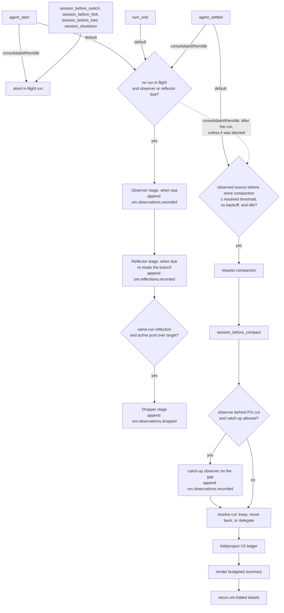

# How it works

This is the V3 technical reference for `pig-observational-memory`, a PiG extension.

V3 is ledger-centered: memory state is reconstructed by folding V3 ledger entries on the current branch. When that projection is non-empty, V3 renders it model-free into the summary the agent sees; no summarization model is called. Before rendering, the compaction hook may run the observer synchronously on source Pi's cut would otherwise discard (see [Compaction hook](#compaction-hook)). Empty projections delegate to Pi's native summarizer.

## Runtime entry points

`extension.go` registers one shared runtime and these surfaces through the PiG SDK:

| Surface | Purpose |
|---|---|
| `agent_start` / `turn_end` consolidation trigger | Maybe launch one background consolidation run: observer, then reflector, then dropper only after a same-run successful reflection. With `consolidateWhenIdle`, `agent_start` aborts an in-flight run instead and `turn_end` does nothing. |
| `agent_settled` consolidation trigger | With `consolidateWhenIdle` only: launch the consolidation run while Pi is idle, then evaluate proactive compaction after it. |
| `agent_settled` compaction trigger | Maybe request a compaction when idle and over the resolved compaction threshold, after Pi finishes retries and queued continuation. With `consolidateWhenIdle`, it runs only after the consolidation run. |
| `session_before_switch` / `session_before_fork` / `session_before_tree` / `session_shutdown` | Abort an in-flight consolidation run quietly; results it has not appended yet are discarded. |
| `session_before_compact` hook | Resolve the compaction cut, observe an unobserved gap synchronously when allowed, and build the V3 compaction payload. |
| `/om:status` | Show ledger counts, drift, progress clocks, backoffs, and worker state. |
| `/om:view` | Show visible or full memory content and attempt to copy the rendered memory text. |
| `memory` tool | Query notes, reflections, raw history and saved memories, recover source evidence for a memory id (`recall <id>`), and write to the curated store. |

## Lifecycle overview



One in-flight flag guards a single consolidation pipeline. A run executes its stages in order: the observer stage, then the reflector stage, which re-reads the branch and so sees observations recorded earlier in the same run, then the dropper stage, which runs only after a non-empty same-run reflection. A stage that is not due is skipped and the run moves on; an observer or reflector failure ends the run. Before appending, each stage checks that the session and the branch it read are still current, and abandons its result when they are not. A session switch, fork, tree jump, or shutdown aborts an in-flight run quietly, without a failure warning, and waits up to a second for it to stop, so a stage past its branch check cannot append to the next branch. With `consolidateWhenIdle`, proactive compaction is evaluated after the idle run finishes, never beside a running worker: the check waits for a run that is due or already in flight, runs at once when there is none, and is skipped when the run was aborted, since an `agent_start` abort means the agent is busy again. The next idle settle runs a skipped check before it launches another run. A settle that finds a run an earlier `agent_start` already aborted waits for it, then settles again.

## Source entries and progress

V3 raw-token progress counts only source entries:

- `message`
- `custom_message`
- `branch_summary`

Memory ledger entries and compaction entries do not add raw-token progress.

Every V3 ledger entry has `data.coversUpToId`. That field is a progress and projection watermark. The observer and reflector clocks count source tokens after the latest valid watermark for their ledger type; when Pi reports provider context usage, provider-reported context growth since that watermark (or since the latest compaction, when coverage is behind it) also counts, and a stage is due when either measure reaches its threshold. The reflector is never due on provider growth alone: it also needs observed source tokens since its watermark, that is, new observations to reflect on.

| Worker/trigger | Progress source |
|---|---|
| Observer | source tokens after the latest `om.observations.recorded.data.coversUpToId`, leaving out entries that render nothing for the observer (`!!command` runs, aborted empty turns) |
| Reflector | observed source tokens: those after the latest `om.reflections.recorded.data.coversUpToId` and up to the latest observation coverage marker |
| Dropper | no clock; runs only after a non-empty same-run reflection, when the folded active observation pool is over `observationsPoolTargetTokens` |
| Auto-compaction | observed source tokens from the latest compaction boundary through the latest observation coverage marker (raw source tokens after the boundary when Pi's `compaction.enabled` is `false`) |

The watermark is also used to decide whether a memory ledger entry belongs to a bounded projection. It is not provenance. Provenance lives in `sourceEntryIds` and `supportingObservationIds`.

## Ledger data shapes

### Observations recorded

```go
// customType "om.observations.recorded"; the entry's data:
type ObservationsRecordedData struct {
	Observations []Observation `json:"observations"`
	CoversUpToID string        `json:"coversUpToId"`
}
```

Each observation:

```go
type Observation struct {
	ID             string    `json:"id"`
	Content        string    `json:"content"`
	Timestamp      string    `json:"timestamp"`
	Relevance      Relevance `json:"relevance"` // "low", "medium", "high" or "critical"
	SourceEntryIDs []string  `json:"sourceEntryIds"`
	TokenCount     int       `json:"tokenCount"`
}
```

The builder rejects empty observation arrays, so no empty progress entries are written.

### Reflections recorded

```go
// customType "om.reflections.recorded"; the entry's data:
type ReflectionsRecordedData struct {
	Reflections  []Reflection `json:"reflections"`
	CoversUpToID string       `json:"coversUpToId"`
}
```

Each reflection:

```go
type Reflection struct {
	ID                       string   `json:"id"`
	Content                  string   `json:"content"`
	SupportingObservationIDs []string `json:"supportingObservationIds"`
	TokenCount               int      `json:"tokenCount"`
}
```

The reflector must cite valid active observation ids.

### Observations dropped

```go
// customType "om.observations.dropped"; the entry's data:
type ObservationsDroppedData struct {
	ObservationIDs []string `json:"observationIds"`
	CoversUpToID   string   `json:"coversUpToId"`
}
```

Drops are tombstones. They remove ids from active observations but do not delete ledger history.

### Folded compaction details

```go
// a compaction entry's details:
type MemoryDetails struct {
	Type               string        `json:"type"`    // "om.folded"
	Version            int           `json:"version"` // 1
	FullFold           bool          `json:"fullFold"`
	Observations       []Observation `json:"observations"`
	Reflections        []Reflection  `json:"reflections"`
	FoldThroughEntryID string        `json:"foldThroughEntryId,omitempty"`
}
```

These details are what later visible projections read. The ledger remains the source of truth.

A compaction has two boundaries. The retention boundary is the compaction's `firstKeptEntryId`, which Pi persists: the first entry kept in context. The fold boundary, `foldThroughEntryId`, is the entry through which the ledger was folded into the summary. They are the same entry unless the hook moved the cut back to keep unobserved source in context, which folds through the latest observation coverage marker; or the earliest marker past Pi's cut straddles it, which folds through that marker; or the latest full fold's boundary lies past the cut, which folds through that boundary. A later compaction reads the fold boundary of the latest full fold, so it applies exactly the drops and reflections that fold applied. Details written without `foldThroughEntryId` fall back to `firstKeptEntryId`.

## Observer flow

The observer is the first stage of the consolidation pipeline. The pipeline launches from `agent_start` and `turn_end`, or from `agent_settled` with `consolidateWhenIdle`.

1. Load config if needed.
2. Skip the launch if `passive` is true.
3. Skip the launch if a consolidation run is already in flight.
4. Skip the launch unless the observer or the reflector is due (see [Source entries and progress](#source-entries-and-progress)); a reflector in its empty-verdict backoff does not count.
5. In the run, skip the observer stage if its progress is below `observeAfterTokens`; the run moves on to the reflector.
6. Honor any deliberate-empty backoff until another `observeAfterTokens` of source tokens the observer can read arrive, coverage changes, the chunk it judged leaves the branch, or the session changes.
7. Resolve the memory model. If no usable model resolves, the run ends.
8. Select the oldest size-capped chunk after the latest observation coverage marker.
9. Serialize those source entries for the observer prompt, with prior memory bounded by `workerMemoryMaxTokens`. Assistant thinking blocks are left out, and `!command` shell executions carry their command and output; `!!command` runs, which PiG keeps out of the agent's context, are left out too.
10. Run the observer, retrying once with `fallbackModel` when the call fails before any observation is accepted.
11. Validate each record in code: its source ids must come from the chunk, its timestamp must be `YYYY-MM-DD HH:MM`, its relevance must be known, and its content must not be empty after trimming; content is folded to one line. The model is told why a record was rejected.
12. Compute deterministic 12-character ids and per-observation token counts in code.
13. Append `om.observations.recorded` only if at least one observation was accepted and the session and branch the stage read are still current.

If no observations are generated, the worker writes no entry and does not advance coverage, and the run continues to the reflector. A later eligible observer run will see a larger range. Deliberate empty runs back off until another `observeAfterTokens` worth of new raw source tokens arrives, so they do not re-fire every turn; like the observer's due check, that count leaves out entries the observer cannot read, such as `!!command` runs. The backoff is measured on the source backlog the observer reads, not on provider-reported growth, so a compaction cannot stretch it, and it is keyed on the chunk it judged, so a branch switch that removes that chunk clears it. Observer chunks are capped at `observerChunkMaxTokens` (minimum 256); when it is unset, the cap is 20% of the memory model's context window (the smaller of the primary and fallback windows when `fallbackModel` is set), or 60,000 estimated tokens when the window is unknown. Complete entries are added oldest-first while they fit, so an oversized uncovered span drains in slices; when the oldest entry alone exceeds the cap, it is sent as a clearly marked head/tail excerpt, preventing coverage from stalling while the original entry stays in the session. When the model call fails or reaches the `agentMaxTurns` cap after some observations were accepted, the stage appends them and advances coverage only through the last source entry they cite; the rest of the chunk is read again on a later run. API/stream failures that leave no accepted observation surface as `observer failed` / `observer.stream_error` rather than as an empty run, and end the run before the reflector.

## Reflect/drop flow

Reflect/drop runs in the same consolidation run, after the observer stage. The reflector stage re-reads the branch, so it sees any observations the observer recorded earlier in the run.

1. Skip the reflector stage if its progress is below `reflectAfterTokens`, or if observation coverage has not moved past reflection coverage (no new observations).
2. Skip it if no observation coverage exists.
3. Skip it while its empty-verdict backoff holds (see below). An empty verdict from a `fallbackModel` retry after a failed primary call does not hold the backoff yet: the primary never judged that memory, so the next run gives it one try, without the fallback retry. The backoff holds once that try fails or records nothing, or when that run is on the fallback again.
4. Resolve the model only for stages that are ready to run.
5. Fold current ledger state.
6. Run the reflector, with prior memory bounded by `workerMemoryMaxTokens` and one retry on `fallbackModel` when the call fails. Each active observation line is annotated with current reflection coverage (`none`, `partial`, or `strong`) so the reflector can review uncovered durable facts without treating coverage as a quota.
7. Append non-empty `om.reflections.recorded` with `coversUpToId` set to the latest observation coverage marker. Support ids are downstream dropper coverage evidence and should include all and only observations whose durable meaning is preserved with equivalent fidelity.
8. Only after that same-run non-empty reflection append, check whether the folded active observation pool is over `observationsPoolTargetTokens`. The check measures every active observation, not only those that fit the dropper's prompt.
9. If over target, run the dropper with same-run reflections available. Its prompt holds the oldest active observations that fit `workerMemoryMaxTokens`, and it can drop only those. It computes a maximum drop count from tokens over target converted to an approximate observation count and annotates active observations with reflection coverage tiers (`none`, `partial`, `strong`) for model judgment.
10. Append non-empty `om.observations.dropped` with `coversUpToId` set to the earlier branch position of latest observation coverage and same-run reflection coverage.

When the reflector records nothing, it backs off: it is not run again until the memory it reads (active observations and reflections) changes or the session changes, apart from the one primary try after a fallback retry's empty verdict (step 3). Reflector no-output and reflector failure skip the same-run dropper. Dropper failure does not roll back already-appended reflections. Like the observer, the reflector and dropper append only while the session and branch they read are still current.

## Auto-compaction trigger

The auto-compaction trigger runs on `agent_settled`, after Pi has finished automatic retries, automatic compaction, and queued continuation. With `consolidateWhenIdle`, it runs only after the idle consolidation run finishes, or at once when no run is due or in flight; when that run is aborted (by `agent_start`, for example), the check is skipped, and the next idle settle runs it before launching another run.

It skips when:

- `passive` is true;
- compaction is already in flight;
- compaction progress is below the resolved threshold;
- a refused compaction's backoff is active (see below);
- Pi does not report idle during the deferred check, which asks up to ten times, 100 ms apart;
- the threshold is no longer met after the deferred check.

Compaction progress counts observed source tokens: estimated source-entry
tokens from the latest compaction boundary through the latest observation
coverage marker. It is zero without observation coverage or while coverage is
behind the boundary, so unobserved source never pushes compaction. When Pi's
own `compaction.enabled` is `false`, the trigger counts raw estimated source
tokens after the boundary instead. The trigger re-reads `compaction.enabled`
from the settings files on every check, so turning automatic compaction off
mid-session takes effect at once. The count starts at `firstKeptEntryId` when
Pi provides that boundary. Memory ledger entries and compaction metadata
contribute zero.

The threshold is resolved by `compactAfterTokensMode`: `"calibrated"` (the
default) uses `compactAfterTokens`; `"ratio"` uses
`floor(contextWindow * compactAfterTokensRatio)` of the session model, falling
back to `compactAfterTokens` when the context window is unknown. The trigger
uses the same metric and threshold before scheduling and in the deferred
re-check, then requests a compaction when all checks pass. When Pi refuses or
fails it (for example "Nothing to compact", "Already compacted", or a
summarizer error), the trigger backs off: it does not ask again until progress
grows by another threshold's worth, a new compaction boundary appears, or the
session changes. A successful compaction clears the backoff, and a cancel from
the compaction hook does not start one.

Outside `consolidateWhenIdle`, this trigger does not wait for a running observer, reflector, or dropper. That is intentional: background memory work should never make compaction feel stuck.

## Compaction hook

The compaction hook runs on `session_before_compact` and is the critical V3 latency path.

It renders deterministically, and calls a model only to catch the observer up:

1. Guard against duplicate concurrent compaction hooks.
2. Load config if needed.
3. Read the event's `preparation.firstKeptEntryId`, `preparation.tokensBefore`, branch entries, `reason`, and `customInstructions`.
4. Resolve the cut. When observation coverage reaches Pi's `firstKeptEntryId`, keep it and fold through it, or through the earliest observation coverage marker past the cut when that marker straddles it (it also covers source before the cut), so its observations of the removed source reach the summary; markers covering only retained source wait for the next compaction. This fold never goes through less than the latest full fold's boundary. When unobserved source in the current compaction range sits before it (the gap), move `firstKeptEntryId` back to the nearest valid cut point at or before the first unobserved entry, so those entries stay in context, and fold through the latest observation coverage marker, within `compactionMaxRetainedTokens`. Source entries that render nothing for the observer, such as an aborted assistant turn with no content, do not count toward the gap. When moving the cut is not possible (overflow recovery, no observation coverage, nothing observed that can be compacted, or a retained tail over budget), the resolution is to delegate.
5. Catch up when there is a gap, `compactionCatchUpMaxChunks` is above `0` (default `2`), observation coverage exists, and no background consolidation run is in flight: run the observer synchronously on the gap, starting at the observation frontier, for up to `compactionCatchUpMaxChunks` chunks, and append `om.observations.recorded` for each chunk that records observations. Chunks use the same request headers and thinking level as the background pipeline; a chunk whose primary model call fails without recording anything is retried once on `fallbackModel`, and later chunks then use the fallback. A chunk that stops early claims coverage only through the last source entry its observations cite. A chunk that records nothing, fails, or is aborted stops the catch-up. If any chunk recorded, re-read the branch and re-resolve the cut.
6. Build a compaction projection from branch entries through the fold boundary.
7. Render a summary from projected reflections and observations within `compactionSummaryMaxTokens`. When the compaction carries `customInstructions`, they are appended after a `---` separator and share that budget; the memory render keeps at least half of it. If records exist but none fits, delegate.
8. For a moved cut, delegate if the retained tokens plus the summary, instructions included, exceed `compactionMaxRetainedTokens`.
9. If the hook delegates or the summary is empty, return no extension result so Pi uses native compaction.
10. Otherwise return `{ compaction: { summary, firstKeptEntryId, tokensBefore, details } }` where `details.type` is `om.folded` and `details.foldThroughEntryId` is the fold boundary.

It does not:

- call a summarization model;
- run reflector/dropper;
- wait for a background consolidation run (catch-up is skipped while one is in flight);
- append ledger entries other than catch-up `om.observations.recorded` entries.

If another compaction hook is already in flight, it returns `{ cancel: true }`. Delegating an empty projection is intentionally different: Pi proceeds with its native summarizer so pre-cut context is preserved.

## Projections

V3 uses projection helpers so commands, compaction, and recall do not each invent their own truth.

### Full projection

Full projection folds valid V3 observations, reflections, and drops from branch root through the requested boundary. Memory entries are included by resolving their `data.coversUpToId` marker against the boundary, not by the physical position of the `om.*` custom entry. Old V2 entries/details, invalid V3-shaped entries, and dangling coverage markers are ignored.

### Visible projection

Visible projection without a boundary reads the `om.folded` details of the newest compaction on the branch. This is what the agent currently sees: Pi shows only the newest compaction's summary, so after a compaction written by Pi's native summarizer, visible memory is empty even when an earlier compaction held V3 records.

### Compaction projection

When compaction runs, the projection helper decides whether this compaction is a full fold. It works on the fold boundary the hook resolved (see [Compaction hook](#compaction-hook)): Pi's `firstKeptEntryId`, the earliest observation coverage marker past it when that marker straddles the cut, or the latest observation coverage marker when the hook moved the cut back. It first builds the normal compaction projection: observations whose `coversUpToId` is at or before the fold boundary, with reflection/drop effects held stable from the latest full-fold boundary (that compaction's `foldThroughEntryId`, else its `firstKeptEntryId`). If there is no previous full-fold boundary, normal compaction includes observations only and excludes reflections/drops. It sums that projection's active observation `tokenCount`; if the total is at or above `observationsPoolMaxTokens`, it performs a full fold through the fold boundary, applying observations, reflections, and drops by coverage marker. Otherwise, it keeps the normal projection. Either way, the details record the fold boundary as `foldThroughEntryId`.

### Diff projection

Diff projection compares visible memory with full memory. `/om:status` uses this to show recorded-vs-visible drift. `/om:status` also reports the visible observation pool separately from the folded active observation pool because compaction pressure and dropper maintenance intentionally use different projections and thresholds.

## Summary rendering

The renderer returns an empty string when there are no visible observations or reflections. Otherwise it starts with deterministic usage instructions that tell the agent how to treat the memory, how to handle conflicts, and when to use the `memory` tool's `recall <id>` for exact source context. It then renders reflection and observation sections when those entries exist:

```md
These are condensed memories from earlier in this session.

- Reflections: stable, long-lived facts about the user, project, decisions, and constraints. New reflection lines may include ids in brackets.
- Observations: timestamped events from the conversation history, in chronological order. Observation lines include ids in brackets.

Treat these as past records. When entries conflict, the most recent observation reflects the latest known state. Work that prior observations describe as completed should not be redone unless the user explicitly asks to revisit it.

When exact source context is needed for precision or traceability, use the memory tool with recall <id> for the relevant observation or reflection. This is especially useful when a reflection materially affects a decision or is too compressed to continue confidently. Find source beyond these records via history | search "words".

## Reflections
[id] durable reflection

## Observations
[id] YYYY-MM-DD HH:MM [relevance] timestamped observation
```

The renderer is deterministic. It does not call a model and does not rewrite memory content.

## Commands

### `/om:status`

Shows:

- passive mode, when `passive` is true;
- recorded/dropped/active/visible observation counts, with plain `+N` / `-N` visible-vs-full drift suffixes when drift exists;
- recorded/visible reflection counts, with a plain `+N` drift suffix when full memory has extra reflections;
- `Next observation`: the larger of readable source tokens since observation coverage and provider-reported growth since it, against `observeAfterTokens` (the measure the observer acts on);
- `Next reflection`: the larger of observed tokens since reflection coverage and provider-reported growth since it, against `reflectAfterTokens`; it reads 0 until an observation lands after reflection coverage, as the reflector is not due before then;
- `Next compaction`: observed source tokens (estimated source tokens when Pi's `compaction.enabled` is `false`) against the resolved compaction threshold;
- `Observer backlog`: unobserved source tokens since the compaction boundary, leaving out entries the observer never reads;
- visible observation pool pressure against `observationsPoolMaxTokens` from visible memory;
- active observation pool pressure against `observationsPoolTargetTokens` from folded active observations;
- reflection pool token total of visible reflections;
- `Observer backoff`, `Compaction backoff`, and `Reflector backoff` lines while the observer's empty-verdict backoff, a refused compaction's backoff, or the reflector's empty-verdict backoff is active, each saying when it resumes (the observer's in backlog tokens, the measure it waits on, not the larger `Next observation` figure);
- an in-flight section (consolidation run and its phase, auto-compaction, compaction hook) when any is running;
- a last-error section with the last observer, reflector, and dropper errors.

### `/om:view`

Default mode shows visible memory and attempts to copy the rendered memory text to the clipboard. Visible memory is empty before the first V3 compaction, because nothing has been folded into `om.folded` details yet, and after a compaction written by Pi's native summarizer, because only the newest compaction counts; use `/om:view full` to inspect recorded branch memory in either case.

Clipboard copy uses platform clipboard commands (`pbcopy`, `clip`, `wl-copy`, `xclip`, `xsel`, or `termux-clipboard-set`). If copying succeeds, the view ends with `Copied /om:view output to clipboard.` If copying fails, the command still prints the memory view and ends it with a warning. The clipboard text is only the rendered memory content; it does not include the success/failure line.

### `/om:view full`

Shows full V3 ledger truth at branch tip and attempts to copy the rendered memory text to the clipboard using the same success/failure behavior as default `/om:view`.

## Recall flow

The `memory` tool's `recall <id>` query looks a 12-character lowercase hex id up first (an id it does not find falls through to an entry id on the branch, then a saved memory or defined query name; [The memory tool](concepts.md#the-memory-tool)).

1. Validate id shape.
2. Read the current branch.
3. Index V3 observations, reflections, and drops from ledger history.
4. Match the id against observations and reflections.
5. For observations, mark status as `active` or `dropped`.
6. Resolve observation source entries from `sourceEntryIds`.
7. For reflections, resolve supporting observations and their sources.
8. Return exact evidence for the sources that resolve, plus diagnostics for missing/non-source entries.

Recall ignores old V2 memory by construction because it indexes only V3 ledger entry types.

## Error and race handling

- One in-flight flag prevents overlapping consolidation runs; separate flags guard the compaction trigger and the compaction hook.
- Stages run in order within a run: the reflector reads the branch after the observer stage, and an observer failure ends the run before the reflector.
- With `consolidateWhenIdle`, `agent_start` aborts an in-flight run, and a session switch, fork, tree jump, or shutdown aborts one in any mode; stages check for the abort before recording errors or appending, so an aborted stage appends nothing and reports no failure.
- Before appending, each stage checks that the session is unchanged and the branch leaf it read is still on the branch; otherwise it abandons its result, so coverage is never claimed for entries that are not on the branch.
- No-output workers append no empty ledger entries.
- Invalid source/support/drop ids are filtered or rejected by code.
- Background worker errors are recorded on runtime state and surfaced in `/om:status`.
- Compaction does not wait for background workers. When no background run is in flight and the observer is behind Pi's cut, the hook may observe the gap synchronously; otherwise it folds whatever ledger state is already present.
- Historical or invalid coverage markers are skipped by progress helpers rather than treated as errors. An entry with one malformed record counts neither as memory nor as coverage, so its span is observed again.

## V2 behavior

V3 does not use V2 state shapes. Old V2 custom memory entries, old V2 compaction details, and old V2 config keys are ignored. Existing old visible compaction text in a continued session may remain visible until a V3 compaction replaces it. The recommended upgrade path is to update settings and start a new clean session.

## Invariants

- The branch-local V3 ledger is the memory source of truth.
- Pi compaction summaries represent what the agent sees.
- Non-empty V3 compaction projections are rendered deterministically, without a summarization model; the hook's only model calls are catch-up observer runs. Empty projections delegate to Pi's native summarizer.
- Observer input is raw/source entries only.
- `coversUpToId` is a progress/projection watermark, not provenance.
- Kept observations and reflections are rendered without paraphrase.
- Dropped observations remain recallable from ledger history.
- Old V2 memory is ignored rather than migrated.
