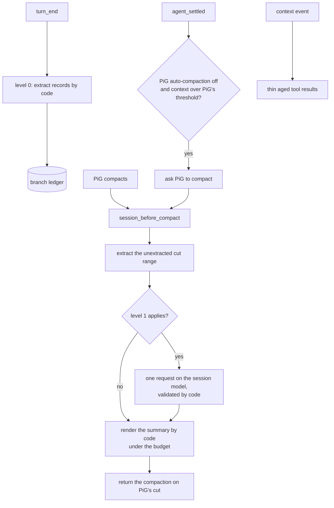

# How it works

This is the technical reference for `pig-observational-memory`, a PiG extension. The design, its rationale and its full rules are in [memory-v2.md](memory-v2.md); this page is the map.

Memory is a ledger of records appended to the session as custom entries and folded on the current branch. Code writes the records as the conversation goes (level 0), with no model request. At a compaction, the extension may make one request on the session model to consolidate them (level 1), then renders the summary from the ledger by code. There is no model request outside a compaction and at most one inside it.

## Runtime entry points

`extension.go` registers one shared runtime and these surfaces through the PiG SDK:

| Surface | Purpose |
|---|---|
| `agent_start` | Load the configuration; subscribe the `context` handler unless passive. |
| `turn_end` | Level 0: extract records from the turn's source entries by code and append them. |
| `agent_settled` | Settle staged curated memories; with PiG's auto-compaction off, request a compaction when the reported context is over PiG's threshold. |
| `context` | Thinning: send aged tool results the latest compaction retained as their level-0 line plus the query that recalls the original. |
| `session_start` | Reload the configuration, reset per-conversation state, migrate the layer written by the earlier engine once, settle curated memories. |
| `session_before_compact` | Extract the unextracted cut range, run level 1 when it applies, and return the compaction on PiG's exact cut. |
| `/om:status` | Show PiG's threshold and the context against it, the last compaction, records by origin, curated memory and the harness. |
| `/om:view` | Show visible or full memory content and attempt to copy the rendered memory text. |
| `memory` tool | Query notes, reflections, raw history and saved memories, recover source evidence (`recall <id>`), and write to the curated store. |

## Lifecycle



1. **Level 0.** At every `turn_end`, code reads the source entries no extraction has read and picks records out of them: user facts, preferences and corrections, the model's words before a tool call, attempts with their outcome, files at their newest state, commits, memory tool notes. Records are appended in one `om.observations.recorded` batch per cut-point segment (a cut-point entry and its tool results), plus an `om.extracted` marker when the last batch does not reach the last entry read.
2. **The trigger.** With PiG's automatic compaction on, PiG compacts on its own. With it off, the extension asks for a compaction at an idle `agent_settled` when the reported context exceeds `contextWindow - reserveTokens`; see [When compactions happen](configuration.md#when-compactions-happen).
3. **The hook.** `session_before_compact` keeps PiG's cut (`firstKeptEntryId`) exactly, extracts whatever of the removed range no turn end read, and folds the ledger.
4. **Level 1.** When it applies ([`consolidate`](configuration.md#consolidate)), one forced-tool request on the session model labels, merges and reflects; code validates every proposal, so a record is dropped only when the record replacing it carries every specific it carries. Any failure appends nothing and level 0 stands.
5. **The summary.** Code renders the folded ledger under the [summary budget](configuration.md#the-summary-budget) (`selection.Render`): ordered classes, every line ending with its anchor, and everything left out printed as a `memory` tool query that lists it. When no record fits, a minimal brief of the removed range is written instead.
6. **Thinning.** Before each provider request, aged tool results the latest compaction retained are sent as their level-0 line and `recall <entry id>`. The plan is decided once per compaction, so request bytes change only at a compaction. The session file keeps every original.

## Source entries and progress

Level 0 reads only source entries: `message`, `custom_message` and `branch_summary`. Memory ledger entries and compaction entries are not source.

Extraction starts after the furthest of: the last `om.observations.recorded` or `om.extracted` marker (`coversUpToId`), the coverage markers the earlier engine wrote, and the latest fold boundary (`ledger.ExtractionStartIndex`). `coversUpToId` is a positional claim: whoever appends one has read every source entry before it. It is a progress watermark, not provenance; provenance lives in `sourceEntryIds` and `supportingObservationIds`.

## Ledger data shapes

### Observations recorded

```go
// customType "om.observations.recorded"; the entry's data:
type ObservationsRecordedData struct {
	Observations []Observation `json:"observations"`
	CoversUpToID string        `json:"coversUpToId"`
	Consolidated bool          `json:"consolidated,omitempty"` // a level-1 batch
}
```

Each record carries an id, its content, timestamp, relevance, `sourceEntryIds` and token count, and optionally its kind, subject, scope, origin (`code`, `model`, `host`; empty for records the earlier engine's workers wrote), outcome, tool and target, status, event date, and its links (`supersedes`, `replaces`, `possiblyUpdates`, `conflicts`). See `internal/ledger/types.go`.

### Reflections recorded

```go
// customType "om.reflections.recorded"; the entry's data:
type ReflectionsRecordedData struct {
	Reflections  []Reflection `json:"reflections"`
	CoversUpToID string       `json:"coversUpToId"`
}
```

Each reflection cites the records it rests on (`supportingObservationIds`) and may name the reflections it replaces (`supersedes`).

### Observations dropped

```go
// customType "om.observations.dropped"; the entry's data:
type ObservationsDroppedData struct {
	ObservationIDs []string `json:"observationIds"`
	CoversUpToID   string   `json:"coversUpToId"`
	Consolidated   bool     `json:"consolidated,omitempty"`
}
```

Drops are tombstones. They remove ids from active records but do not delete ledger history, so a dropped record stays recallable.

### Folded compaction details

A compaction's `details` are `om.folded` (`ledger.MemoryDetails`): the folded records and reflections, the summary format used, the subject aliases, which records the summary showed, and the level-1 report (`consolidation`) that `/om:status` reads. A compaction's fold boundary is its `firstKeptEntryId`. Compactions the earlier engine wrote may carry a separate `foldThroughEntryId` (it moved the cut back to keep unobserved source); a later compaction reads that boundary for them, so it applies exactly the drops and reflections that fold applied.

When the latest compaction is not one the ledger backs (PiG's own summary, or one from before the extension was installed), the next compaction stores its summary once as one record with origin `host`.

## Commands

### `/om:status`

Shows, in order:

- passive mode, when `passive` is true;
- a `Settings` section when the project's settings were not read (see [Project trust](configuration.md#project-trust)), and the removed settings a settings file still sets ("Removed settings, ignored: ...");
- records by who added them (code, the model, host summaries, the earlier engine's workers), dropped and active, and reflections recorded and standing;
- whether PiG's auto-compaction is on, PiG's threshold and the context against it;
- the last compaction's level, request count, what level 1 recorded, and why it did not run or failed;
- the trigger's suspension after "Nothing to compact", and what is in flight;
- curated memory (live, staged, flagged, refused files) and the harness (profile, rules, held definitions).

### `/om:view`

Default mode shows visible memory (what the latest compaction folded) and attempts to copy the rendered memory text to the clipboard. Before the first compaction, or after one PiG's own summarizer wrote, visible memory is empty; the command says so in one line and points to `/om:view full`. Reflections that level 1 replaced are left out.

Clipboard copy uses platform clipboard commands (`pbcopy`, `clip`, `wl-copy`, `xclip`, `xsel`, or `termux-clipboard-set`), only those that can reach a clipboard. If copying succeeds, the view ends with `Copied /om:view output to clipboard.`; if a usable command fails, it ends with a warning; with none usable, the first view in the process notes that the output is not copied. The clipboard text is only the rendered memory content.

### `/om:view full`

Shows the full ledger at the branch tip, with the same clipboard behavior.

## Recall flow

The `memory` tool's `recall <id>` looks a 12-character lowercase hex id up among records and reflections first; an id it does not find falls through to an entry id on the branch, then a saved memory or defined query name (see [The memory tool](concepts.md#the-memory-tool)). For a record it reports whether it is active or dropped and returns the source entries its `sourceEntryIds` name; for a reflection, its supporting records and their sources. A text longer than one page is paged on line boundaries (`recall <id> offset N`).

## Error and race handling

- Every hook that extracts appends; a concurrent or cancelled one is deduplicated against a fresh branch read under one lock, and record ids hash content and sources, so the same extraction never appends twice.
- Level 1 failing in any way (no tool call, stream error, cut output, abort, nothing valid) appends nothing; the compaction is still returned.
- A panic anywhere in the compaction handler is recovered into the minimal brief.
- Only a cancelled `session_before_compact` request makes the hook answer nothing.
- Invalid ids in model output are refused by code.
- An entry with one malformed record counts neither as memory nor as coverage, so its span is extracted again.

## Data from the earlier engine

Sessions and stores written by the earlier engine (background observer, reflector and dropper) still load: their records, reflections, drops, coverage markers and folded compactions fold as before, and extraction starts after their coverage. Its written layer instructions are migrated once at session start, its rules and held definitions are listed but never applied, and its usage events do not count toward the profile. Its settings are ignored and listed in `/om:status`.

## Invariants

- The branch-local ledger is the memory source of truth.
- No model request outside a compaction; at most one inside it (level 1, on the session model).
- Every compaction PiG prepares is owned, on PiG's exact cut.
- Compaction never discards source no extraction read: the hook extracts the cut range before rendering.
- The summary is rendered by code from the ledger, never summary of summary; everything left out is reachable with a printed query.
- A record is dropped only when the record replacing it carries its specifics.
- Dropped records remain recallable from ledger history.
